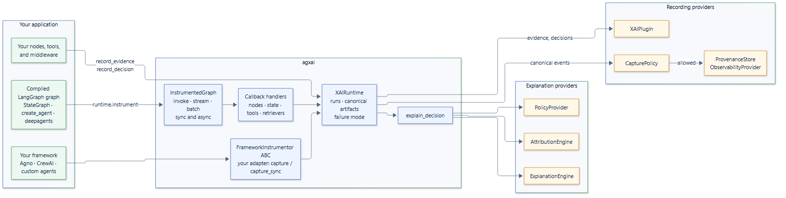

<p align="center">
  
</p>

<h1 align="center">agxai</h1>

<p align="center">
  <a href="https://github.com/smuniharish/agxai/actions/workflows/ci.yml"></a>
  <a href="https://agxai.readthedocs.io/"></a>
  <a href="https://pypi.org/project/agxai/"></a>
  <a href="https://pypi.org/project/agxai/"></a>
  
  
  <a href="https://github.com/smuniharish/agxai/blob/master/LICENSE"></a>
</p>

**Recorded evidence, decisions, and audience-safe explanations for AI agents.**

agxai records what your agent ran, the evidence it used and the decisions it
made, then explains each decision to the reader asking: in full for an
auditor, with internal scores withheld for a customer. It works with LangGraph
and LangChain out of the box, and with any other framework through one ABC.

<p align="center">
  
</p>

## Why agxai

An agent routes a payment to human review. The customer asks why, and so does
an auditor. Today the usual answers fall short:

- **Traces show what ran, not why.** LangSmith, Langfuse and OpenTelemetry
  record spans, latency and tokens. They don't record which evidence a decision
  rested on, or which alternatives were rejected.
- **Asking the model to explain itself gives a story, not evidence.** A
  rationale written after the fact can't be traced back to recorded facts.
- **Different readers need different answers.** An auditor needs the fraud
  score and its source; a customer must not see it. Redacting by hand in each
  endpoint is easy to get wrong.
- **Explainability code ends up tied to one framework.** Moving from LangGraph
  to another framework means rewriting it.

How agxai addresses each one:

| Problem | What agxai does |
| --- | --- |
| Traces don't say why | Records evidence, decisions, alternatives and provenance as typed, versioned data, next to the execution it captures automatically |
| Self-explanations aren't evidence | Builds explanations only from those records; it never records or invents a model's private reasoning |
| Audiences need different views | A disclosure policy decides what each audience sees, and withheld sections are announced, never silently dropped |
| Code tied to one framework | A framework-neutral core; LangGraph and LangChain are an optional extra, and other frameworks plug in through `FrameworkInstrumentor` |

agxai doesn't replace your tracing. Its events can be sent to LangSmith,
Langfuse or any OpenTelemetry backend, joined to your traces by run and trace
ID.

## Highlights

- **Drop-in LangGraph and LangChain capture.** `runtime.instrument(graph)`
  records `invoke`, `stream`, `batch`, `astream_events` and the other Runnable
  entry points, sync and async, with inputs, outputs and exceptions unchanged.
  It works with `StateGraph`, the functional API, `create_agent`, `deepagents`,
  subgraphs and MCP tools.
- **Human-in-the-loop aware.** Interrupts and resumes are recorded with the
  reviewer's answer, and a resumed run is linked to the checkpoint and run it
  continues, even across processes.
- **Explanations from records.** Attribution shows how much each factor and
  piece of evidence contributed; every statement traces back to a record.
- **Per-audience disclosure.** Developers, auditors, business owners and end
  users each get what their policy allows.
- **Safe by default.** Credentials are redacted before anything is stored,
  explanations fail closed, LLM phrasing needs two explicit opt-ins, and
  instrumentation failures never break your graph unless you ask them to.
- **Extensible through ABCs.** Subclass `FrameworkInstrumentor` for Agno,
  CrewAI or your own loop, and `ProvenanceStore` for your database. A complete
  PostgreSQL store is included as an example.
- **Small and typed.** The core depends only on Pydantic, ships type hints,
  and is tested on Python 3.12 to 3.15 with 100% statement and branch coverage.

## Installation

```bash
pip install "agxai[langgraph]"   # with LangGraph and LangChain
pip install agxai                # core only, for any other framework
```

Optional extras:

| Extra | Adds |
| --- | --- |
| `langgraph` | LangGraph 1.x and LangChain Core 1.x instrumentation |
| `langsmith` | `LangSmithObservability` |
| `langfuse` | `LangfuseObservability` |
| `otel` | `OpenTelemetryObservability` |
| `llm-openai` | LLM-phrased explanations with `langchain-openai` |
| `all` | Every extra above |

## Quickstart

A payment-review node records the fraud score as evidence and routes the
payment to human review. The same decision is then explained to an auditor and
to the customer, whose policy withholds the score:

```python
import asyncio
from typing import TypedDict

from langgraph.graph import START, StateGraph

from agxai import (
    Audience,
    DecisionFactor,
    DecisionType,
    EvidenceType,
    PolicyDecision,
    PolicyProvider,
    XAIRuntime,
)


class HideScoresFromCustomers(PolicyProvider):
    async def evaluate(self, context, action):
        hidden = {"contributing_factors", "supporting_evidence"}
        return PolicyDecision(
            context=context.execution.context,
            policy_id="hide-scores",
            action=action,
            allowed=True,
            audience=context.audience,
            denied_fields=hidden if context.audience == Audience.END_USER else set(),
        )


runtime = XAIRuntime(application_id="payments")
runtime.register(PolicyProvider, HideScoresFromCustomers())


class Payment(TypedDict, total=False):
    amount: float
    route: str


async def review(state: Payment) -> Payment:
    score = await runtime.record_evidence(
        EvidenceType.TOOL_RESULT, summary="Fraud model scored 0.91."
    )
    await runtime.record_decision(
        "HUMAN_REVIEW",
        decision_type=DecisionType.ROUTING,
        candidate_actions=["AUTO_APPROVE", "HUMAN_REVIEW"],
        factors=[DecisionFactor(name="fraud_score", value=0.91, evidence_ids=[score.id])],
        evidence_ids=[score.id],
    )
    return {"route": "HUMAN_REVIEW"}


graph = runtime.instrument(StateGraph(Payment).add_node(review).add_edge(START, "review").compile())


async def main() -> None:
    with runtime.collect_runs() as runs:
        await graph.ainvoke({"amount": 9200.0})
    (run,) = runs
    for audience in (Audience.AUDITOR, Audience.END_USER):
        explanation = await runtime.explain_decision(run.decisions[0], audience=audience, run=run)
        print(f"[{audience}]", *explanation.reasons, *explanation.disclosure, sep="\n  ")


asyncio.run(main())
```

Output:

```text
[auditor]
  Selected action: HUMAN_REVIEW.
  Alternatives considered: AUTO_APPROVE.
  Factor fraud_score was 0.91.
[end_user]
  Selected action: HUMAN_REVIEW.
  Alternatives considered: AUTO_APPROVE.
  Contributing factors are withheld by policy.
  Supporting evidence is withheld by policy.
```

The [quickstart](https://agxai.readthedocs.io/en/latest/getting-started/quickstart/)
builds a two-node version step by step.

### Your own framework

The core has no framework dependency. Wrap your agent's entry point in
`capture()` and record evidence and decisions as above:

```python
from agxai import FrameworkInstrumentor


class AgentInstrumentor(FrameworkInstrumentor[Agent, Agent]):
    def instrument(self, target: Agent) -> Agent:
        async def call(amount: float) -> str:
            async with self.capture():
                return await target(amount)

        return call


agent = AgentInstrumentor(runtime).instrument(review)
```

See the [custom framework guide](https://agxai.readthedocs.io/en/latest/integrations/custom-frameworks/).

### Your own database

Records are kept in memory by default. Subclass `ProvenanceStore` and register
it; `agxai.testing.ProvenanceStoreContract` checks your store against the
contract:

```python
from agxai import ProvenanceStore


class MyStore(ProvenanceStore):
    async def write(self, item): ...
    async def get(self, entity_id, *, context): ...
    def query(self, query): ...
    async def children(self, entity_id, *, context): ...
    async def parents(self, entity_id, *, context): ...
    async def delete_run(self, context): ...


runtime.register(ProvenanceStore, MyStore())
```

See the [PostgreSQL store example](https://agxai.readthedocs.io/en/latest/examples/postgres-store/).

## Benchmarks

A five-node LangGraph graph, 500 runs per scenario, with the default in-memory
store:

| Scenario | p50 ms | p95 ms | Added at p50 |
| --- | ---: | ---: | ---: |
| Without agxai | 6.68 | 7.81 | |
| agxai, no provider | 7.99 | 9.62 | +1.3 ms |
| agxai + OpenTelemetry | 11.02 | 14.93 | +4.3 ms |
| agxai + Langfuse | 20.57 | 29.16 | +13.9 ms |

Measured on one machine; see
[Benchmarks](https://agxai.readthedocs.io/en/latest/benchmarks/) for the method,
memory use and how to reproduce.

## Examples

Complete programs in [`examples/`](https://github.com/smuniharish/agxai/tree/master/examples),
each run in CI with its output checked:

- [Fraud review: full explanation](https://agxai.readthedocs.io/en/latest/examples/full-explanation/)
- [Human-in-the-loop](https://agxai.readthedocs.io/en/latest/examples/interrupt-hitl/)
- [Multi-agent retries and correlation](https://agxai.readthedocs.io/en/latest/examples/multi-agent-retry/)
- [Disclosure matrix](https://agxai.readthedocs.io/en/latest/examples/disclosure-matrix/)
- [Custom framework](https://agxai.readthedocs.io/en/latest/examples/custom-framework/)
- [PostgreSQL store](https://agxai.readthedocs.io/en/latest/examples/postgres-store/)

## Documentation

Full documentation: **[agxai.readthedocs.io](https://agxai.readthedocs.io/)**

- [Getting started](https://agxai.readthedocs.io/en/latest/getting-started/)
- [User guide](https://agxai.readthedocs.io/en/latest/guide/)
- [Integrations](https://agxai.readthedocs.io/en/latest/integrations/)
- [API reference](https://agxai.readthedocs.io/en/latest/api/)

Two [Agent Skills](https://agxai.readthedocs.io/en/latest/agent-skills/) teach
coding agents such as Claude Code, Codex, Cursor and GitHub Copilot to use
agxai correctly. `agxai` integrates it into your application, and
`agxai-extend` writes instrumentors for other frameworks and stores for your
database:

```bash
npx skills add smuniharish/agxai
```

agxai 1.x follows semantic versioning: minor releases add features without
breaking your code or your stored records. Changes are listed in the
[changelog](https://github.com/smuniharish/agxai/blob/master/CHANGELOG.md).

## Contributing

Contributions are welcome. See
[CONTRIBUTING.md](https://github.com/smuniharish/agxai/blob/master/CONTRIBUTING.md)
for the development setup and checks, and
[SECURITY.md](https://github.com/smuniharish/agxai/blob/master/SECURITY.md)
to report a vulnerability.

## License

Apache License 2.0. See
[LICENSE](https://github.com/smuniharish/agxai/blob/master/LICENSE).
