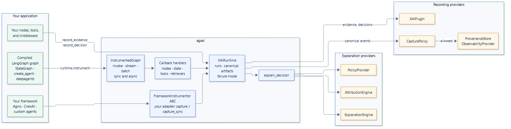

# Architecture overview

`agxai` is a library that runs inside your process. It has three
layers: framework-specific instrumentation that observes an agent call, a runtime that turns
observations into canonical records, and replaceable providers that store,
export, attribute, filter, and explain them.

## Components

| Component | Responsibility |
| --- | --- |
| `FrameworkInstrumentor` | Framework extension ABC with sync/async capture helpers. Custom adapters translate their framework's public lifecycle into runtime recording calls. |
| `InstrumentedGraph` | A transparent proxy around a compiled graph. Starts and finishes a run for each top-level call, such as `invoke`, `stream`, or `astream_events`, and each batch input. Attaches the callback handler and, for a checkpointed thread, links the run to its checkpoints and to the run it continues. |
| Callback handlers | Recognize LangGraph nodes, state changes, tool calls, retrievers, and interrupts from LangChain callbacks, and record them through the runtime. |
| `XAIRuntime` | Owns configuration, the registry, and plugins. Builds canonical records, applies redaction and the capture policy, delivers records to sinks, enforces concurrency, timeouts, and the failure mode, and assembles explanations. |
| `Registry` | Maps each capability base class to the provider one runtime uses, rejecting providers that do not subclass it. |
| Providers | Subclasses of the capability abstract base classes `ProvenanceStore`, `ObservabilityProvider`, `CapturePolicy`, `PolicyProvider`, `AttributionEngine`, and `ExplanationEngine`, all with built-in defaults. |
| Plugins | Subclasses of the `XAIPlugin` abstract base class; receive every evidence, decision, and memory record. |

## Lifecycle of a LangGraph call

The bundled `langgraph` extra provides the proxy below. Custom frameworks use
the same runtime lifecycle via `FrameworkInstrumentor.capture()` or
`capture_sync()`; see [Custom frameworks](../integrations/custom-frameworks.md).

1. `graph.ainvoke(input, config)` reaches the `InstrumentedGraph`. If the call
   continues a checkpointed thread, the proxy reads the checkpoint it starts
   from and the run that wrote it.
2. The runtime starts a run: it builds the `ExecutionContext` from the config,
   records a `running` `Execution`, and emits `execution.started`.
3. The wrapped graph runs with the callback handler and the run ID added to its
   config. The run is bound to the current context, so nodes can call
   `record_*` methods.
4. Each recognized node, state change, tool call, retrieval, and interrupt
   becomes a record on the run's `Execution` and an event for the store and
   observability provider.
5. When the graph returns, raises, is cancelled, or pauses, the proxy records
   the last checkpoint the run wrote, and the runtime finishes the run and
   writes the final `Execution`.
6. The graph's output, or its exception, reaches the caller unchanged.

Explanations are built later, on request. See [Runtime](runtime.md) for the
details of each step.

## Design principles

- **Observe, never interfere.** Instrumentation uses LangGraph's public
  Runnable and callback APIs, does not patch LangGraph, and never changes
  inputs, outputs, or exceptions.
- **Facts, not reasoning.** Execution is captured. The basis of a decision is
  recorded explicitly by the application. Private model reasoning is never
  collected or inferred.
- **Safe by default.** Credentials are redacted before records exist,
  explanations are policy-filtered or not returned at all, and LLM phrasing
  needs two opt-ins.
- **Isolated by construction.** Every record carries application, tenant, and
  run IDs; stores scope every query by them; runtimes share no global state.
- **Replaceable everything.** Every capability has a small contract and a
  working default, so a backend can be swapped without touching the runtime.

## Package layout

| Module | Contents |
| --- | --- |
| `agxai.core` | Canonical models and capability base classes |
| `agxai.runtime` | `XAIRuntime`, `Run`, `Registry`, `XAIInstrumentationError`, `RUN_ID_METADATA_KEY` |
| `agxai.integrations` | `FrameworkInstrumentor` ABC (no framework dependencies) |
| `agxai.integrations.langgraph` | Optional `LangGraphInstrumentor`, `InstrumentedGraph`, and callback handlers |
| `agxai.policy` | Redaction, `DefaultCapturePolicy`, `DefaultPolicyProvider` |
| `agxai.attribution` | `HybridAttribution`, `RuleBasedAttribution`, `EvidenceAttribution` |
| `agxai.explanation` | `StructuredExplanationEngine`, `LLMExplanationEngine` |
| `agxai.storage` | The `ProvenanceStore` base class, `InMemoryProvenanceStore`, `StoreFilter` |
| `agxai.observability` | LangSmith, Langfuse, OpenTelemetry, and no-op adapters |
| `agxai.plugins` | `XAIPlugin`, `PluginManager` |

Core classes are importable from the top-level `agxai` package; optional
framework classes are imported from their integration modules.
The [API reference](../api/index.md) lists every
public class and function with the module it lives in.
