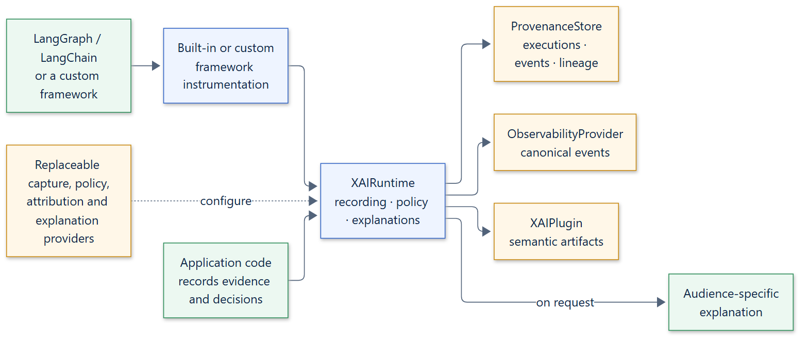

# Architecture overview

`agxai` is a library that runs inside your process. It has three
layers: framework-specific instrumentation that observes an agent call, a runtime that turns
observations into canonical records, and replaceable providers that store,
export, attribute, filter, and explain them.

## Components

| Component | Responsibility |
| --- | --- |
| `FrameworkInstrumentor` | Framework extension ABC with sync/async capture helpers. Custom adapters translate their framework's public lifecycle into runtime recording calls. |
| `InstrumentedGraph` | A proxy around a compiled graph that records top-level calls, including supported checkpoint and continuation information. |
| `XAIRuntime` | Owns configuration, the registry, and plugins. Coordinates recording, capture controls, providers, and explanations. |
| `Registry` | Maps each capability base class to the provider one runtime uses, rejecting providers that do not subclass it. |
| Providers | Subclasses of the capability abstract base classes `ProvenanceStore`, `ObservabilityProvider`, `CapturePolicy`, `PolicyProvider`, `AttributionEngine`, and `ExplanationEngine`, all with built-in defaults. |
| Plugins | Subclasses of the `XAIPlugin` abstract base class; receive every evidence, decision, and memory record. |

## Recording and explaining a run

The bundled `langgraph` extra provides graph instrumentation. Custom frameworks
use the runtime lifecycle via `FrameworkInstrumentor.capture()` or
`capture_sync()`; see [Custom frameworks](../integrations/custom-frameworks.md).

An instrumented call records supported execution observations while
application code can add evidence and decisions. The store receives
executions, permitted events, and provenance links; the observability provider
receives permitted events. Semantic artifacts are delivered to plugins.
Applications can request an audience-specific explanation from the recorded
facts. See [Runtime](runtime.md) for behavior and failure handling.

## Design principles

- **Observe, never interfere.** Instrumentation uses LangGraph's public
  Runnable and callback APIs, does not patch LangGraph, and never changes
  inputs, outputs, or exceptions.
- **Facts, not reasoning.** Execution is captured. The basis of a decision is
  recorded explicitly by the application. Private model reasoning is never
  collected or inferred.
- **Safe by default.** Credential-named keys in supported captured values are
  redacted, explanations are policy-filtered or not returned at all, and LLM
  phrasing needs two opt-ins. See the [redaction limits](../guide/concepts/policies.md#redaction).
- **Isolated by construction.** Every record carries application, tenant, and
  run IDs; stores scope every query by them; runtimes share no global state.
- **Replaceable everything.** Every capability has a small contract and a
  working default, so a backend can be swapped without touching the runtime.

## Package layout

| Module | Contents |
| --- | --- |
| `agxai.core` | Canonical models and capability base classes |
| `agxai.runtime` | `XAIRuntime`, `Run`, `Registry`, `XAIInstrumentationError`, `RUN_ID_METADATA_KEY` |
| `agxai.integrations` | `FrameworkInstrumentor` ABC (no framework dependencies) |
| `agxai.integrations.langgraph` | Optional `LangGraphInstrumentor`, `InstrumentedGraph`, and callback handlers |
| `agxai.policy` | Redaction, `DefaultCapturePolicy`, `DefaultPolicyProvider` |
| `agxai.attribution` | `HybridAttribution`, `RuleBasedAttribution`, `EvidenceAttribution` |
| `agxai.explanation` | `StructuredExplanationEngine`, `LLMExplanationEngine` |
| `agxai.storage` | The `ProvenanceStore` base class, `InMemoryProvenanceStore`, `StoreFilter` |
| `agxai.observability` | LangSmith, Langfuse, OpenTelemetry, and no-op adapters |
| `agxai.plugins` | `XAIPlugin`, `PluginManager` |

Core classes are importable from the top-level `agxai` package; optional
framework classes are imported from their integration modules.
The [API reference](../api/index.md) lists every
public class and function with the module it lives in.
