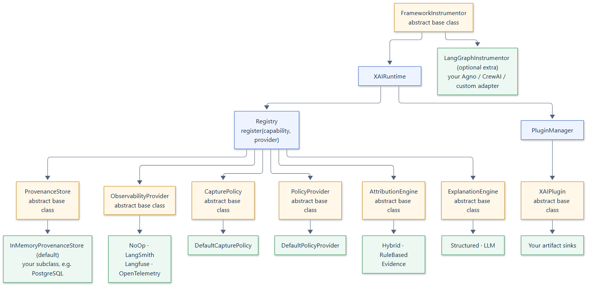

# Extensibility

## Agent frameworks

The core has no framework dependency. Subclass the `FrameworkInstrumentor`
ABC and implement `instrument(target)`, using its `capture()` or
`capture_sync()` helpers to manage runs and context. `LangGraphInstrumentor`
implements the bundled LangGraph/LangChain integration in the `langgraph`
extra. Agno, CrewAI, and others can be connected by developer-written
instrumentors; see [Custom frameworks](../integrations/custom-frameworks.md).

## Runtime providers

Every capability of the runtime has a small, typed contract and a working
default. Each contract is an abstract base class: a provider subclasses it and
implements its abstract methods. `runtime.register` rejects any object that
does not subclass the capability, even if it has methods with the right names,
so a provider is checked when it is registered rather than when it is first
called. Each runtime resolves providers through its own `Registry`, so swapping
a backend never requires changing the runtime.



## Capabilities

| Capability | Implement | Inherited | Built-in providers |
| --- | --- | --- | --- |
| `ProvenanceStore` | `write`, `get`, `query`, `parents`, `children`, `delete_run` | `lineage`, `close`; checked by `agxai.testing.ProvenanceStoreContract` | `InMemoryProvenanceStore` (default); a [PostgreSQL store](../examples/postgres-store.md) in the examples |
| `ObservabilityProvider` | `emit` | `flush`, `close` (no-ops) | `NoOpObservability` (default), `LangSmithObservability`, `LangfuseObservability`, `OpenTelemetryObservability` |
| `CapturePolicy` | `evaluate(event)` | | `DefaultCapturePolicy` (default) |
| `PolicyProvider` | `evaluate(context, action)` | | `DefaultPolicyProvider` (default) |
| `AttributionEngine` | `attribute(context)` | | `HybridAttribution` (default), `RuleBasedAttribution`, `EvidenceAttribution` |
| `ExplanationEngine` | `explain(context)` | `requires_llm = False` | `StructuredExplanationEngine` (default), `LLMExplanationEngine` |

Every method is `async`. Register a provider with
`runtime.register(Capability, provider)`, which raises `TypeError` unless the
provider subclasses the capability, and replaces the previous provider.
`runtime.registry.require(Capability)` returns the active provider.

A runtime's registry is its own. To share providers between runtimes, for
example one store for several tenants' runtimes, register the same provider
instance in each, or pass one `Registry` to several runtimes.

## Plugins

Plugins receive the semantic records that do not go to the store: every
evidence, decision, and memory record as it is created, and anything passed to
`record_artifact`. Use one to persist them, index them for search, or forward
them to a review queue. A plugin subclasses the `XAIPlugin` abstract base class
and implements `record`; `flush` and `close` are optional hooks.

```python
from agxai import XAIPlugin, XAIRuntime


class Archive(XAIPlugin):
    """Keeps every evidence and decision record (use your database)."""

    def __init__(self) -> None:
        self.artifacts = {}

    async def record(self, artifact) -> None:
        self.artifacts[artifact.id] = artifact


runtime = XAIRuntime(plugins=(Archive(),))
```

Add plugins at construction or later with `runtime.plugins.add(plugin)`; both
raise `TypeError` for an object that does not subclass `XAIPlugin`. Every
plugin receives every call, even when another plugin fails. The failures are
then raised together, as an `ExceptionGroup` if there are several, and handled
by the failure mode once. Plugins are closed in reverse registration order.

## Writing a provider

Subclass the capability's base class and keep these contracts, and the
runtime's guarantees hold for your provider too:

- **Stores** subclass `ProvenanceStore` and make writes idempotent upserts
  keyed by application, tenant, run, record type, and ID. An `Execution` is
  written several times per run, and the latest write must win. Queries must be
  scoped by application and tenant; `get`, provenance queries, and
  `delete_run` also by run; and results must come back in a stable order. The
  inherited `lineage` then behaves like the built-in store's. Run
  `agxai.testing.ProvenanceStoreContract` against the store to prove it; see
  [Storage](storage.md#testing-a-store).
- **Observability providers** should not block the event loop. Run blocking SDK
  calls in a thread, or use the SDK's background batching. Subclassing
  `ObservabilityAdapter` gives you deduplication, closed-state checks, and
  consistent error wrapping; you implement `_emit` and, optionally, `_flush`
  and `_close`.
- **Capture policies** run once per event, so keep them fast. Return a
  `PolicyDecision` with `action=PolicyAction.CAPTURE`.
- **Exposure policies** return a `PolicyDecision` with
  `action=PolicyAction.EXPOSE`; see [Policies](../guide/concepts/policies.md#exposure-policy)
  for how its fields are applied.
- **Attribution engines** return an `AttributionResult` whose `subject_id` is
  the decision's ID. Signed scores, normalized to an absolute sum of 1, keep
  explanations comparable.
- **Explanation engines** set `requires_llm = True` if they call a model, so the
  runtime's opt-in gate applies. They must honor the policy decisions in
  `context.policies` and say in `disclosure` what they withheld.

Errors from any provider are handled by the runtime's
[failure mode](runtime.md#failure-handling). Providers do not need their own
error policy.
