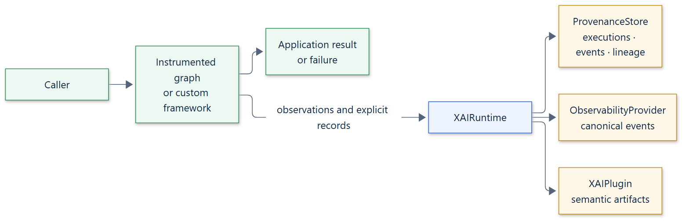

# Runtime

`XAIRuntime` turns observations into canonical records and delivers them to
providers. This page describes how a run flows through it, how runs follow your
code across tasks and threads, and how concurrency, timeouts, and failures are
handled.

## Runs

A `Run` is the in-memory handle on one execution. It holds the live `Execution`
and semantic records such as `run.evidence` and `run.decisions`.

- **`start_run(config, continuation_of=...)`** builds the `ExecutionContext`
  from a config mapping (`metadata` / `configurable`, compatible with LangChain),
  records a `running` `Execution`, and emits
  `execution.started`. `continuation_of` names the run this one continues.
- **`record_*` methods** create one canonical record each. Execution records
  (nodes, state changes, tools, retrievals, checkpoints, human interactions)
  are added to the `Execution` and emitted as events, unless the
  [capture policy](../guide/concepts/policies.md#capture-policy) drops them. Semantic
  records (evidence, decisions, memory references) are kept on the run and
  delivered to plugins.
- **`finish_run(run, error, cancelled=..., interrupts=..., pending_nodes=...)`**
  sets the final status, records the exception, the interrupts, or the nodes a
  static breakpoint stopped before, emits the terminal event, and writes the
  final `Execution`.

A record added after a run has finished, such as an approval made outside the
graph, rewrites the stored `Execution`, so the store never falls behind the
in-memory run.

## Custom framework calls

`FrameworkInstrumentor.capture()` and `capture_sync()` start a run, activate
it for recording calls, and finish it with the correct outcome. `activate_run`
can also scope a manually managed run without changing its lifecycle.
See [Custom frameworks](../integrations/custom-frameworks.md).

## LangGraph instrumented calls

`InstrumentedGraph` records a run for each supported top-level call and, when
checkpoint capture is enabled, links continued runs to their checkpoints.
Interrupts and resumes are recorded across the supported entry points and
stream modes. See the [LangGraph integration](../integrations/langgraph.md)
for supported calls, checkpoint requirements, and limitations.

## Context propagation

The active run is stored in a context variable. That is why `runtime.current_run`
works inside nodes, tools, and middleware without passing anything around:

- LangGraph and LangChain copy the context into the tasks and threads that run
  nodes, so the run follows the call into subgraphs, agents, and tools.
- For streaming calls, the run is bound only while the wrapped graph produces
  the next chunk. Your code between chunks runs outside it.
- A call made while an instrumented call of the same runtime is active joins
  that call's run instead of starting its own.
- `collect_runs()` uses a context variable too. It collects the runs started in
  its block and in tasks spawned from it, but not runs started concurrently
  elsewhere.

Different runtimes never see each other's runs: `current_run` returns a run
only to the runtime that started it.

## Synchronous code

The runtime is asynchronous. `runtime.run_sync(coroutine)` runs a coroutine from
synchronous code. It is used by the instrumentation of `invoke`, `stream`, and
`batch`, and by synchronous nodes that record evidence.

The caller's context, including the current run and any active OpenTelemetry
span, carries over. It also works when the calling thread already runs an
event loop, such as in a notebook. Event-loop-bound clients must still be used
on their owning loop; see the [PostgreSQL example](../examples/postgres-store.md).

## Concurrency and timeouts

Every provider call (store write, event emit, capture-policy check, exposure
policy, attribution, explanation, plugin delivery) is one *operation*.

- At most `max_concurrency` operations run at once across the runtime's threads
  and event loops. Waiting operations are served first come, first served.
- Each operation has one budget of `operation_timeout_seconds`. Waiting for a
  slot and running the operation both count against it, so a saturated or slow
  backend surfaces as a `TimeoutError` instead of a stalled graph.
- Event sequence numbers give concurrently recorded events a total order
  within a run.

## Failure handling

An operation that raises or times out is handled once, centrally:

1. The error is appended to `runtime.errors`, which keeps the last 100 errors.
2. In `FAIL_OPEN`, the operation is skipped and the graph continues.
3. In `FAIL_CLOSED` and `STRICT`, `XAIInstrumentationError` is raised, with the
   original error as `__cause__`. Callback handlers are registered so that
   LangChain re-raises it from the graph call instead of logging it.

Two rules take precedence over the failure mode:

- **The graph's own exception wins.** If the graph fails and recording that
  failure also fails, the graph's exception is raised and the recording error
  is logged.
- **Explanations fail closed.** `explain` and `explain_decision` raise in every
  mode when the policy, attribution, or engine fails.

Cancellation (`asyncio.CancelledError`, `KeyboardInterrupt`) is never
swallowed. The run is recorded as cancelled, and the cancellation propagates.

## Closing

`await runtime.close()` flushes the observability provider and plugins, then closes
the store, the observability provider, and the plugins. Every step is attempted
even if an earlier one fails. In `FAIL_CLOSED` and `STRICT` the first failure is
raised afterwards. Closing is idempotent. A closed runtime refuses to start new
runs.
