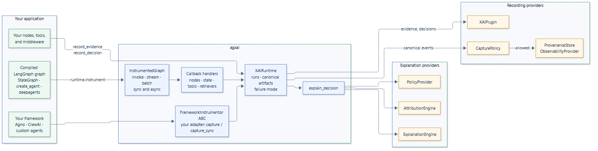

---
hide:
  - navigation
  - toc
---

<div class="ax-hero" markdown>

# agxai

<p class="ax-tagline">Recorded evidence, decisions, and audience-safe
explanations for AI agents. Instrument a LangGraph graph, or any framework
through one ABC, and explain each decision in a form an auditor can check and a
customer may see.</p>

[Get started](getting-started/index.md){ .md-button .md-button--primary }
[Browse examples](examples/index.md){ .md-button }
[API reference](api/index.md){ .md-button }

</div>

## Why agxai

Tracing tools show what an agent ran. When someone asks *why* it decided
something, the answer is usually a model's after-the-fact rationale, and the
same text goes to an engineer, an auditor and a customer. agxai records the
basis of each decision as data and builds every explanation from those records.

<div class="grid cards" markdown>

-   :material-file-document-check-outline:{ .lg .middle } __Explanations from records__

    ---

    Every statement traces back to recorded evidence or a decision factor. agxai
    never records or invents a model's private reasoning.

-   :material-account-group-outline:{ .lg .middle } __One record, many audiences__

    ---

    A disclosure policy decides what developers, auditors, business owners and
    end users see. Withheld sections are announced, never silently dropped.

-   :material-chart-timeline-variant:{ .lg .middle } __Beyond tracing__

    ---

    Tracing answers what ran and how long it took. agxai answers why, and sends
    its events to LangSmith, Langfuse or OpenTelemetry next to your traces.

-   :material-account-check-outline:{ .lg .middle } __Human-in-the-loop aware__

    ---

    Interrupts, the reviewer's answer and resumes are recorded, and a resumed
    run is linked to the checkpoint and run it continues.

-   :material-puzzle-outline:{ .lg .middle } __Framework-agnostic__

    ---

    LangGraph and LangChain are built in as an extra. Agno, CrewAI or your own
    loop plug in through `FrameworkInstrumentor`; any database through
    `ProvenanceStore`.

-   :material-shield-check-outline:{ .lg .middle } __Safe by default__

    ---

    Credentials are redacted before storage, LLM phrasing needs two opt-ins,
    and instrumentation failures never break your graph unless you ask them to.

</div>

## Thirty-second tour

=== "pip"

    ```bash
    pip install "agxai[langgraph]"
    ```

=== "uv"

    ```bash
    uv add "agxai[langgraph]"
    ```

A payment-review node records the fraud score as evidence and routes the
payment to human review. The same decision is then explained to an auditor and
to the customer, whose policy withholds the score:

```python
import asyncio
from typing import TypedDict

from langgraph.graph import START, StateGraph

from agxai import (
    Audience,
    DecisionFactor,
    DecisionType,
    EvidenceType,
    PolicyDecision,
    PolicyProvider,
    XAIRuntime,
)


class HideScoresFromCustomers(PolicyProvider):
    async def evaluate(self, context, action):
        hidden = {"contributing_factors", "supporting_evidence"}
        return PolicyDecision(
            context=context.execution.context,
            policy_id="hide-scores",
            action=action,
            allowed=True,
            audience=context.audience,
            denied_fields=hidden if context.audience == Audience.END_USER else set(),
        )


runtime = XAIRuntime(application_id="payments")
runtime.register(PolicyProvider, HideScoresFromCustomers())


class Payment(TypedDict, total=False):
    amount: float
    route: str


async def review(state: Payment) -> Payment:
    score = await runtime.record_evidence(
        EvidenceType.TOOL_RESULT, summary="Fraud model scored 0.91."
    )
    await runtime.record_decision(
        "HUMAN_REVIEW",
        decision_type=DecisionType.ROUTING,
        candidate_actions=["AUTO_APPROVE", "HUMAN_REVIEW"],
        factors=[DecisionFactor(name="fraud_score", value=0.91, evidence_ids=[score.id])],
        evidence_ids=[score.id],
    )
    return {"route": "HUMAN_REVIEW"}


graph = runtime.instrument(StateGraph(Payment).add_node(review).add_edge(START, "review").compile())


async def main() -> None:
    with runtime.collect_runs() as runs:
        await graph.ainvoke({"amount": 9200.0})
    (run,) = runs
    for audience in (Audience.AUDITOR, Audience.END_USER):
        explanation = await runtime.explain_decision(run.decisions[0], audience=audience, run=run)
        print(f"[{audience}]", *explanation.reasons, *explanation.disclosure, sep="\n  ")


asyncio.run(main())
```

Output:

```text
[auditor]
  Selected action: HUMAN_REVIEW.
  Alternatives considered: AUTO_APPROVE.
  Factor fraud_score was 0.91.
[end_user]
  Selected action: HUMAN_REVIEW.
  Alternatives considered: AUTO_APPROVE.
  Contributing factors are withheld by policy.
  Supporting evidence is withheld by policy.
```

The runtime records the graph's execution automatically; your code adds the
evidence and the decision. Explanations are built from those records:

{ .diagram }

## Let your coding agent integrate it

Install the [agxai Agent Skills](agent-skills/index.md) and your coding agent
learns the workflow and rules for adding agxai to your application, and for
extending it to other frameworks and databases:

```text title="Agent instruction"
Install the Agent Skills from https://github.com/smuniharish/agxai
(agxai-skills/skills/agxai and agxai-skills/skills/agxai-extend) into
this project, run the agxai skill's scripts/verify_setup.py, then add
explainability to this application with agxai, following the skill's
workflow and rules.
```

## Where to go next

<div class="grid cards" markdown>

-   :material-rocket-launch:{ .lg .middle } __[Quickstart](getting-started/quickstart.md)__

    ---

    Build a fraud-review graph step by step and explain its decision.

-   :material-book-open-variant:{ .lg .middle } __[User guide](guide/index.md)__

    ---

    The records agxai keeps, and how-to guides for common tasks.

-   :material-connection:{ .lg .middle } __[Integrations](integrations/index.md)__

    ---

    LangGraph, custom frameworks, LangSmith, Langfuse and OpenTelemetry.

-   :material-code-braces:{ .lg .middle } __[Examples](examples/index.md)__

    ---

    Complete programs, tested in CI, with their real output.

-   :material-speedometer:{ .lg .middle } __[Benchmarks](benchmarks.md)__

    ---

    Measured latency and memory overhead, and how to reproduce them.

-   :material-api:{ .lg .middle } __[API reference](api/index.md)__

    ---

    Every public class and method, generated from the source.

</div>
